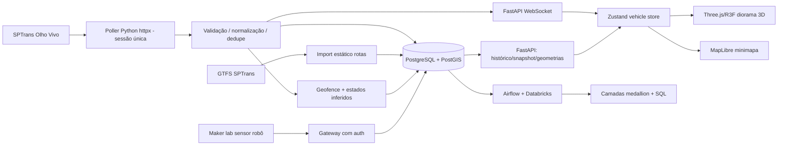

# PÁTIO MONITOR — BLUEPRINT DE IMPLEMENTAÇÃO V2.0

**Status:** especificação aprovada para início técnico, NÃO implementação concluída. **Data:** 6/11/2026. **Objetivo do sprint web:** 6–12/11. **GS completa:** 19/11, 23h55, horário de São Paulo. **Referências do usuário:** `references/01-game-bus-depot.png`, `02-isometric-logistics.png`, `03-etra-electra.png`.

## 1. Definição de produto e hipótese

Uma experiência web que permite observar os ônibus registrados pela SPTrans numa área geográfica selecionada em São Paulo, inspecionar o histórico de posições, visualizar eventos inferidos de entrada/saída e navegar numa representação tridimensional do espaço. O diferencial a testar é se uma representação espacial com replay/eventos torna compreensível um estado operacional que hoje exige múltiplas ferramentas.

**Usuário-alvo hipóteses:** operador de garagem/terminal ou pesquisador de mobilidade. **Não afirmar venda/ROI/fit validado sem entrevistas.** Primeira experiência pública educacional, não software homologado de controle de despacho. Não existem integrações privadas de manutenção, combustível ou programação interna da garagem.

**Pergunta que responde:** “Quais veículos foram realmente observados nesta área, onde estavam e quando chegaram/deixaram de ser observados? Qual é o grau de confiança dessa informação?” A resposta de vaga exata não é garantida.

## 2. Direção visual: city-builder paulista, não painel corporativo

Referência prioritária: 01 jogo de pátio (câmera e modelos 3D); 02 logística branca/isométrica (clareza e legibilidade); 03 ELECTRA (informações localizadas sobre ônibus). A estética final **não** deve copiar textos, layout completo, marcas ou assets dos exemplos.

- Paleta principal: base marfim `#F5F5F1`, asfalto `#B9BDB8`, cimento `#DADDD8`, folhagem `#527A62`, tinta escura `#17242B`, azul de seleção `#2779D2`, verde confirmativo `#1C997D`, amarelo de inferência `#D8942F`, vermelho incidente `#D75B55`. São cores da identidade **do produto**, não alegação de padrão oficial SPTrans.
- Tipos: **Plus Jakarta Sans** para interface e **IBM Plex Mono** para códigos, timestamps e valores. Aplicar licenças webfont apropriadas.
- Cena: ortográfica isométrica 35–45°, órbita limitada, pan/zoom controlados, sombreamento suave, ambient occlusion otimizada e antialiasing. Modelo de ônibus **low-poly bem modelado / semi-realista**, não voxel, bloco ou desenhado por CSS. Proporção realista e detalhes visíveis: para-brisa curvo, rodas/aro, janelas, portas, frente letreiro, espelhos e detalhes do teto. Veículos com pintura ilustrativa inspirada nos ônibus paulistanos; só reproduzir layout oficial/licenciado quando comprovado.
- Bairro: ruas e edifícios 3D extrudados de polígono OSM, calçadas, árvores instanciadas; entrar apenas em área com geometrias e permissões verificadas. Dimensões/alturas ausentes = aproximação **visual** informada.
- Interface: 75–85% da tela ocupada pela cena. Barra superior de título+modo+time/source; filtros compactos, painel contextual do ônibus selecionado (aparece ao clicar, some ao fechar); timeline na borda inferior; minimapa real com MapLibre em canto; sem laterais cheias de números inventados, sem “cards de KPI” decorativos.
- Motion: câmera suave ao selecionar, destaque `outline` discreto, ícone de sinal/latência, barras apenas para informação real. 30–60 fps alvo no desktop de referência medido por Playwright + teste manual.
- Responsividade: desktop primário, tablet útil, mobile fallback com câmera limitada e painel contextual deslizante. Ao não suportar WebGL, mostrar mapa e lista de veículos reais com aviso explícito.

## 3. Decisão de motor e stack (sem menu ambíguo)

| Componente | Escolha fechada | Por quê |
|---|---|---|
| Frontend | **Vite + React 19 + TypeScript** | App client-side com WebGL, rápido para iterar e fácil de hospedar. Não precisamos SSR neste MVP. |
| Cena 3D | **Three.js + `@react-three/fiber@9`** | Objetos WebGL, glTF, atualização por frame, input e câmera 3D; estável com React 19. |
| Helpers 3D | **`@react-three/drei`** | `useGLTF`, `CameraControls`, `Environment`, `Text`, seleção e raycasts. |
| Assets | **Blender -> GLB/glTF 2.0 -> `@gltf-transform/cli`** | Modelos reais com materiais PBR, licenças registradas, compressor de textura. |
| Coordenadas | **proj4 / pyproj** | WGS84 -> UTM 23S EPSG:32723 -> plano local em metros (X=leste, Z=-norte, Y=altura). |
| Minimap / mapas externos | **MapLibre GL JS** | Geografia real e fonte de tiles licenciada; não substituir o canvas 3D. |
| Estado | **Zustand** | Mapas de veículos, estado de seleção, modo e filtros. |
| REST caching | **@tanstack/react-query** | Snapshots, historical replay, loading, retry. |
| CSS e controles | **Tailwind + shadcn/ui + Lucide** | Só interface 2D. Nada de veículos CSS, sprites improvisados ou DOM como mundo 3D. |
| Backend | **Python 3.12 + FastAPI + Pydantic 2 + httpx** | Adaptador Olho Vivo, contratos, endpoints, websocket. |
| Persistência | **PostgreSQL 16 + PostGIS** | Histórico, eventos geográficos, geofencing, índices. |
| Transporte realtime | **WebSocket do FastAPI** | Broadcast de snapshots já normalizados, sem 1 sessão SPTrans por usuário. |
| Ingestão batch FIAP | **Airflow 3 + Databricks Free** | Bronze/Prata/Ouro para BI; NÃO pertence ao caminho de baixa latência dos WebSockets. |
| CI/CD e deploy FIAP | **Docker Compose, GitHub Actions, Gitleaks, Semgrep, Trivy, Terraform** | Cobertura do edital, scanner, infraestrutura documentada. |
| Observabilidade | **Prometheus + Grafana**, host local se for exigido | métricas GOLDEN signals (latência, tráfego, erros, saturação) e alerta demonstrado. |
| E2E / QA | **Playwright + pytest + Vitest** | conferir canvas real e fluxo em browser, API e transformações. |

Não adotar Unreal/Unity/Godot web no primeiro sprint: são opções válidas em outras condições, mas aumentam peso e a integração com UI/react/telemetria em um prazo curto. Não adotar Next.js por inércia; app majoritariamente WebGL não precisa de SSR. Não colocar dois mecanismos de renderização MapLibre e R3F no mesmo viewport na primeira semana. `@deck.gl/maplibre` + `ScenegraphLayer` é alternativa futura para veículos 3D georreferenciados no mapa de rotas.

**Versões:** pin do lockfile após `pnpm install`; não usar alpha do React Three Fiber. Verificar peer deps antes do scaffold.

## 4. Origem do mundo 3D: coordenadas *reais* vs maquete

1. Escolher apenas **um pátio ou terminal** após obter API e confirmar posições observadas naquela área. Registrar polígono+fonte+licença e a data do levantamento.
2. Importar uma vez (build-time, não continuamente no browser) os recortes **OSM** para edifícios, caminhos, ruas, árvores e limites que realmente existirem. Se garagens privadas estiverem faltando, **não inventar sua distribuição de baias**. Mostrar arquitetura indicativa com rótulo `geometria ilustrativa` ou usar apenas terreno/edifícios verificados.
3. Preprocessar GeoJSON para malhas GLB/geometria cacheadas; aplicar materiais game-like. Identificar `height` ou níveis quando disponível e, quando não, usar altura visual aproximada explicitamente identificada, não anúncio de medição.
4. Projetar todos polígonos e posições do GPS para o mesmo referencial: WGS84 EPSG:4326 -> UTM 23S EPSG:32723 (São Paulo) -> subtrair origem definida no terreno; **1 unidade Three.js = 1 metro**. Convenção: X=leste, Z=-norte, Y=elevação. Testar pontos conhecidos e distâncias.
5. `GPS -> veículo 3D`: atualização da posição em mapa real. Orientação só se a fonte fornecer heading confiável, ou inferência de 2+ pontos com deslocamento suficiente e ruído controlado (badge `inferido`). Não projetar ônibus artificialmente dentro de baia, nem fazê-los atravessar edifícios na interpolação.
6. GTFS `shapes.txt` descreve caminhos gerais das **viagens nas linhas**, não pistas internas de garagem. Não usar `shapes.txt` para alegar rota de manobra dentro do pátio.
7. Dados OSM em ODbL: atribuir © OpenStreetMap contributors e verificar necessidade de share-alike para bancos derivados; imagens, tiles e asset `.glb` têm licenças independentes.

## 5. Pipeline de ASSETS: sem ônibus-quadrados

- **Asset obrigatório:** `assets/vehicles/sp-standard-bus.glb` (ou nome equivalente) com corpo realista estilizado, chassi, janela frontal, janelas laterais, portas, rodas independentes, letreiro, retrovisores e materiais. Opcional ônibus articulado para segunda versão.
- **Como obter:** (A) modelagem autoral em Blender, (B) modelo comprado/licenciado para redistribuição web, (C) um modelo CC válido para uso com atribuição; registrar autor/licença/URL. Não copiar modelo proprietário de videogame ou usar print/textura extraída do jogo.
- **Organização de nós sugerida:** `Body`, `Windows`, `Wheels`, `Doors`, `Lights`, `Livery`, `DestinationSign`. Origem em centro do solo, eixo longitudinal definido e documentado. Materiais PBR e textura atlas para facilidade de recoloração.
- **Otimização:** export GLB com escala em metros, checar carga no GLTFLoader, rodar `gltf-transform optimize input.glb output.glb --texture-compress webp` ou formatos compactados compatíveis; não misturar Draco/Meshopt sem configurar decoder. Variantes de pintura por materiais/instâncias; não baixar 20 cópias do arquivo.
- **Gates visuais obrigatórios:** screenshot do ônibus em 3/4 dianteiro, perfil e vista de cima; validação automática de GLB com nós/mesh; rodar cena com mínimo 8 ônibus, 3 seleções e mover câmera em browser. Ausência de GLB bloqueia a liberação da cena; nenhuma substituição silenciosa por `BoxGeometry`.
- **Performance alvo:** cena 30+ FPS num notebook comum medido, peso total inicial dos assets ideal < 15 MB, arquivo de ônibus preferencialmente < 3 MB comprimido e fallback 2D em WebGL indisponível. Metas de design, não garantias.

## 6. Contrato de dados e regra contra 'realtime fake'

Fonte primária oficial: SPTrans Olho Vivo API v2.1, `POST /Login/Autenticar?token=...` -> cookie HTTP; `GET /Empresa`, `GET /Posicao/Garagem?codigoEmpresa=...` e/ou `GET /Posicao/Linha?codigoLinha=...`. Resposta inclui `p` prefixo, `py` latitude, `px` longitude, `ta` timestamp; bloco superior pode conter código e letreiro da linha. O endpoint de garagem consulta por **empresa**, não entrega layout/vaga exata. Não inferir autorização de saída, velocidade medida, combustível, SOC, manutenção ou GPS interno de precisão.

```ts
type Mode = 'LIVE' | 'REPLAY' | 'DEMO';
type LocationEvidence = 'OBSERVED' | 'INFERRED' | 'ILLUSTRATIVE';
interface VehicleObservation {
  vehicleId: string; lineId?: string; lineLabel?: string;
  latitude: number; longitude: number;
  observedAt: string; receivedAt: string;
  source: 'sptrans_olhovivo' | 'recorded' | 'synthetic';
  mode: Mode; evidence: LocationEvidence;
  positionAgeSeconds: number;
  inferredHeadingDegrees?: number;
}
```

A API deve expor pelo menos: `GET /health`, `GET /api/vehicles/snapshot`, `GET /api/vehicles/{vehicle_id}/history`, `GET /api/geo/depot`, `GET /api/events`, `WS /ws/vehicles` com envelope JSON validado/versionado e atualização idempotente. Ingerir upstream uma vez em worker/serviço, não por navegador, com cookie privado; timeout, cache, deduplicação, retries exponenciais, limite de chamadas, circuit-breaker, auditoria e últimas posições legíveis mesmo após queda.

**Tempo real significa ingestão de observações publicadas recentemente pelo provedor**, não timestamp inventado. Implementar aged states configuráveis (`fresh`, `delayed`, `stale`) com base em `observed_at`; parâmetros de 30/90 segundos são apenas valores iniciais e devem mudar conforme teste da frequência real. Mostrar `última leitura` permanentemente. Para posição antiga, congelar modelo + estado de baixa confiança; nunca animar sem dados.

**Interpolação:** quando há 2 observações próximas e caminhos plausíveis, animar visualmente ao longo da conexão confirmada com delay pequeno; se a distância for grande/obstáculo/ângulo inconsistente, realizar atualização sem trajetória inventada. `heading` inferido é opcional e deve ser baseado em movimento significativo entre dois pontos; em repouso manter última orientação válida ou exibir direção desconhecida. GPS não implica precisão de vaga. Entrada/saída pelo limite de polígono com histerese e confirmação de 2+ leituras e badge `inferido`.

**Replay:** gravar os pacotes reais e replay fiel nos timestamps originais em fluxo reprocessado; o UI exibe selo REPLAY, data/hora. **Demo:** fixtures sintéticas são permitidas para validar UX, mas sempre DEMO visível. Modo LIVE só habilitado se token, conectividade e observações reais estiverem disponíveis.

## 7. Arquitetura principal



O frontend pode usar uma API proxy na mesma origem para evitar CORS. Para o MVP com UMA instância do backend, o poller pode correr no lifespan do FastAPI; se múltiplas réplicas/worker, separar como serviço único para impedir polling duplicado. O Airflow é **batch**, não rota do websocket em baixa latência.

## 8. Organização de código aprovada

```text
patio-monitor/
  AGENTS.md
  apps/web/
    src/app/                 # rotas, providers, wire-up
    src/features/depot-3d/   # canvas, camera, scenery, bus GLB renderer
    src/features/fleet/      # cards contextuais, selection, filters
    src/features/map/        # MapLibre minimap (opcional etapa 3)
    src/features/timeline/   # replay control
    src/lib/geo/             # geodesy + local projection
    src/lib/realtime/        # websocket client/reconciliation
    src/store/               # zustand
    public/models/           # GLB + LICENSE manifests
  services/api/
    app/adapters/sptrans.py
    app/domain/observations.py
    app/domain/geofence.py
    app/http/vehicles.py
    app/realtime/socket.py
    app/storage/repository.py
    tests/
  packages/contracts/       # JSON Schemas/OpenAPI generated TS types
  pipelines/airflow/         # dags batch GS
  pipelines/databricks/      # bronze, prata, ouro, consultas
  maker/                    # interface serial/http do robô
  infra/terraform/
  infra/monitoring/
  docs/
  assets/licenses/
  .github/workflows/
```

## 9. Tela principal e fluxo UX

**Abertura:** marca “Pátio Monitor” no canto esquerdo superior; seletor `Garagem/Área`, selo `LIVE / REPLAY / DEMO` e `Última atualização 22:14:07`; cena 3D clara domina tela; minimapa mostra local real; contorno/labels dos veículos. **Interação:** clicar bus -> câmera aproxima suavemente -> card flutuante com prefixo, linha, coordenadas aproximadas e hora real; botão Seguir ônibus; voltar vista geral; filtrar linha -> atualiza somente veículos escolhidos. **Replay:** rodapé timeline com date-picker ou slider, só disponível em dados efetivamente registrados.

Desenho de vista isométrica de 3/4 em dia claro; grade do chão opcional e discreta; placas e vegetação no estilo São Paulo, sem estetização neon cyberpunk; cor de linhas por dados da operação quando verificável, senão scheme consistente não oficial.

NUNCA renderizar campos fake de `combustível`, `odômetro`, `status de limpeza`, `Saída autorizada`, `receita` ou `pontualidade` sem dados e lógica verificados. Nenhum número arbitrário como 146 ônibus ativos; mostrar somente quantidade filtrada de observações válidas.

## 10. Entregas por marcos; não escopo solto

| Marco | Datas alvo | Entrega verificável / gate |
|---|---|---|
| P0 - Dados e local | 6/11 | Login SPTrans com token; sample local privado; tabela de qualidade; escolha de perímetro com polígonos/licença. Se falhar: decidir DEMO transparente e não chamar LIVE. |
| P1 - Asset e scene | 7–8/11 | Um GLB bus real, licença, cenário isométrico carregável, orbit/pan/zoom, seleção, screenshot de QA; sem API ainda. |
| P2 - Vertical slice | 9–10/11 | Backend normaliza posição e passa WS; cena recebe snapshot e atualiza 3D; modo DEMO/REPLAY correto; timestamps e fonte. |
| P3 - Geografia e replay | 11–12/11 | Geometria de área real, projeção testada, mini-mapa/replay, design refinado, browser QA e URL web funcional. |
| P4 - GS integracoes | 13–17/11 | Airflow/Databricks; RAG local+agente testes; CV customizada; RPA auditável; sensor robô; Terraform/CI/CD/monitoramento; mostrar separadamente evidência real. |
| P5 - fechamento | 18–19/11 | Vídeos, pitch, PDFs, README, links públicos, testes finais e Teams até 23:55 de 19/11. |

**Risco de prazo:** sete disciplinas não ficam automaticamente concluídas com um frontend. Trabalhos devem ocorrer em paralelo na equipe.

## 11. Critérios de aceite e testes contra “HTML de estagiário”

- [ ] WebGL Canvas **ativo** sem screenshot ou CSS 3D. `three` e `@react-three/fiber` no bundle.
- [ ] `bus.glb` real renderizado; `GLTFLoader` carrega sem erro e componente contém janelas, rodas, portas e letreiro.
- [ ] 8 ônibus usando assets reais na cena de DEMO; cena não usa BoxGeometry como ônibus.
- [ ] Câmera livre com zoom/pan/rotação delimitados, hit-test sobre ônibus, foco/retorno animados.
- [ ] Real coordinates end-to-end; 2 pontos de referência batem com pontos reais dentro da tolerância documentada.
- [ ] Dados exibem `source`, `observedAt` e `mode`; `LIVE` bloqueado com token ausente.
- [ ] Stale/reconnect/error states implementados e testados.
- [ ] `REPLAY` não pede GPS ao vivo; timeline não inventa observações inexistentes.
- [ ] Sem chave em frontend/repo, boas práticas de autoria de assets e OSM/tile attribution.
- [ ] E2E: abre cena, seleciona ônibus, altera modo, vê timestamp, foca câmera, testa falha do WebSocket.
- [ ] Performance medido na máquina de teste, visual comparado manualmente aos três screenshots.
- [ ] README documenta onde a cena é ilustrativa e onde há dados medidos.

**Definição de pronto:** testes + imagem de QA + vídeo curto da cena 3D funcionando + links; não aceitar “componente criado” como sinônimo de funcionamento.

## 12. Integração FIAP — mapa de trabalhos restantes (nenhum automaticamente concluído)

- **Generative AI (mobilidade):** LLM local com corpus de documentos de mobilidade e fonte, RAG vs agente, recusa ao não encontrar, conjunto gabaritado e 5 erros medidos.
- **Big Data:** duas fontes pertinentes (Olho Vivo e GTFS, com pelo menos uma externa oficial), Airflow, ingestão em dois lotes no Databricks Free, Bronze/Prata/Ouro, fato + dimensões e 5 SQL, hash LGPD (se houver PII; preferir não coletar).
- **Computer Vision:** treinamento customizado de detector de ônibus/obstáculos em imagens com train/val e demo em vídeo; não substituir por chamada genérica pronta.
- **RPA:** Python script processa coleções de observações, identifica indisponibilidade/falha, produz eventos, logs, screenshots e vídeo de até 3 minutos, com exceções.
- **Secure DevOps:** Dockerfile nonroot, compose, CI Gitleaks/Semgrep/Trivy, Terraform criando serviço cloud, demo de pipeline barrado e corrigido, dashboard+alerta 4 sinais.
- **Maker:** evoluir robô anterior com sensor extra e decisão de IA; transmitir medida para `/api/maker/events` e registrar em fonte **MAKER** separada de SPTrans, vídeo de até 6min.
- **BI & startup:** problema real documentado, demo URL pública, modelo de negócio hipotético transparente, indicadores medidos e pitch vídeo <=5min.

## 13. Riscos e decisões que precisam ser provadas

1. Token SPTrans é credencial solicitada pelo usuário; sem isso não há LIVE verificado.
2. `Posicao/Garagem` por empresa, não geofence definida por usuário; teste amostras e combinem com polígono local, se licença permitir.
3. Micro-localização em vaga exige infraestrutura adicional; não afirmar.
4. Geo OSM pode faltar telhados/vagas/galpões; ilustrar parcialmente com legenda ou obter outro dataset permitido.
5. Renderizado 3D pode consumir GPU; implementar LOD/culling/instancing e fallback.
6. Um digital twin operacional de fato requer dados da garagem e integração contratual; MVP da FIAP é visualização pública parcial, não controle de frota.
7. Modelos/tiles têm direitos autorais independentes. Licença e atribuição por asset.
8. Custo cloud/Terraform: obter preço atual do provedor antes de criar, nunca expor infraestrutura pública gratuita como garantida.

## 14. Decisões de engenharia para registrar em ADR

- `ADR-001`: Three.js/R3F + mapas secundários separados, ao invés de engine de jogo WebGL.
- `ADR-002`: Projeção para UTM 23S, 1 unidade = 1 metro.
- `ADR-003`: LIVE/REPLAY/DEMO obrigatório.
- `ADR-004`: modelo GLB é requisito de aceite, não espaço reservado substituível por div.
- `ADR-005`: Airflow batch fora do canal realtime.
